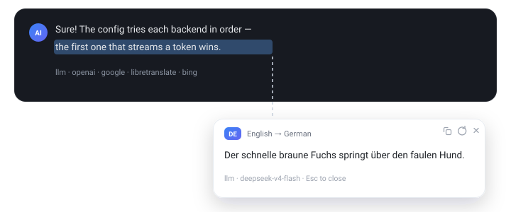
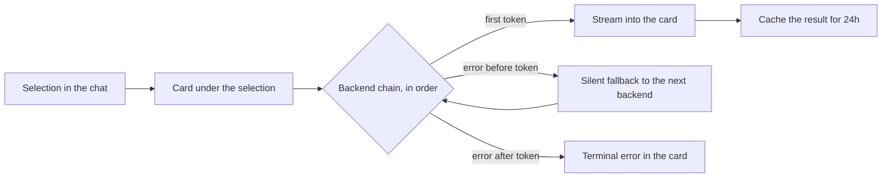

<div align="center">

# dsh-translate-card

**Select text. Read the translation in place.**

A translation card that appears right under any selection in the DeepSeek Harness chat — your own model first, a configurable fallback chain behind it.



[](LICENSE)
[](#development)
[](#development)

[Quick start](#quick-start) · [Backends](#backends) · [Configuration](#configuration) · [How it works](#how-it-works) · [Privacy](#privacy) · [Development](#development)

</div>

---

## Highlights

- 🔒 **Private by default** — the first backend is your own DSH model. Text leaves your machine only if you explicitly add a public backend to the chain.
- ⚡ **Streaming** — model translations render token by token; long sentences never feel frozen.
- 🔁 **Fallback chain** — a backend that dies before the first token is replaced silently by the next one. A backend that dies mid-stream shows an error, because you already see a partial translation.
- 🎯 **Any target language** — one line in the config: `"to": "ru"`, `"en"`, `"de"`, `"zh-Hans"`, …
- 🧩 **Zero dependencies** — no install scripts, no native modules, no `npm install`.
- 🎛 **Fully configurable** — backend order, model route, timeouts, API keys via environment variables.
- ⌨️ **Explicit trigger** — selecting text shows a small `Translate` pill; nothing is translated (or sent anywhere) until you click it or press the hotkey `Alt+Shift+T` (`Option+Shift+T` on macOS). Copying with `Cmd/Ctrl+C` is never intercepted.
- 🧹 **Respects the composer** — selections inside input fields and whole-page `Ctrl+A` never trigger a card.

## Quick start

```sh
dsh plugin --profile desktop add "link:/abs/path/to/dsh-translate-card"
```

Restart DeepSeek Harness once (the injection table is built at host startup), then select any text in an answer: a small pill appears under the selection. Click it or press `Alt+Shift+T` (`Option+Shift+T` on macOS) to translate. `Esc` closes the card, `⟳` retries with a cache bypass, the copy button copies the translation.

Out of the box: the private `["llm"]` chain only — nothing leaves your machine unless you add a public backend yourself. Target language `ru`, host-side cache 24 hours.

Install straight from GitHub:

```sh
dsh plugin --profile desktop add "github:waldemarpng/dsh-translate-card"
```

Pin an exact revision by appending a git ref, for example `#v0.1.0`. For local development, clone the repository and use the `link:` form above.

## Backends

Each id can appear anywhere in the `backends` chain, any number of times.

| id | Speaks | Streaming | Timeout | Where the text goes |
|---|---|---|---|---|
| `llm` | DSH model service (`ctx.llm`), the model picked in the GUI, or a route fixed in the config | ✅ | `timeoutMs` | Your model provider only |
| `openai` | Any OpenAI-compatible `/v1/chat/completions`: Ollama, llama.cpp, vLLM, OpenRouter, … | ✅ | `timeoutMs` | Wherever `baseUrl` points |
| `google` | Public `translate.googleapis.com` endpoint, no key | — | ≤ 15 s | Google |
| `libretranslate` | Self-hosted or public LibreTranslate | — | ≤ 15 s | Wherever `baseUrl` points |
| `bing` | Public cn.bing.com, MyMemory as an in-backend fallback | — | ≤ 15 s | Microsoft, then MyMemory |

## Configuration

Config lives in `~/.dsh/.dsh-translate-card.json` (or `$DSH_HOME/.dsh-translate-card.json`). It is re-read on every request — no restart. A broken config is reported inside the card and never crashes the host.

| Field | Meaning |
|---|---|
| `to` | Target language, `ru` by default. |
| `enabled` | `false` disables translation without unloading the plugin. |
| `trigger` | `button` (default) — translate only after clicking the pill or pressing the hotkey; `auto` — translate as soon as text is selected (the previous behaviour). |
| `hotkey` | Hotkey that translates the current selection: `alt+shift+t` by default. `mod` maps to `Cmd` on macOS and `Ctrl` on Windows/Linux; `alt` is `Option` on macOS. Accepts `ctrl`, `alt`, `shift`, `meta`, one key (`a`-`z`, `0`-`9`, `f1`-`f12`), or `off` to disable. |
| `skipTargetLanguage` | `true` (default) — do not show the card when the selection is already in the target language. Set `false` to translate everything. |
| `backends` | Array of backend ids in attempt order. Defaults to `["llm"]`, the private chain. |
| `backend` | Deprecated alias: `auto` now means the private default chain, `llm` / `bing` select a single backend. Mutually exclusive with `backends`. |
| `timeoutMs` | Timeout for `llm` and `openai`, 1000–300000, default 45000. The other backends are capped at 15000. |
| `llm` | `{ "provider", "model" }` — a fixed route instead of the GUI selection. Both fields together. |
| `openai` | `{ "baseUrl", "model", "apiKeyEnv" }`. `model` is required; `apiKeyEnv` names an environment variable holding the key and must end in `_API_KEY`, `_KEY` or `_TOKEN`. A remote `baseUrl` must be `https://` — plain `http://` is accepted for loopback hosts only, so an API key is never sent in clear text. |
| `libretranslate` | `{ "baseUrl", "apiKeyEnv" }`; a local instance needs no key. |

### Recipe 1 — your own model, public fallback

```json
{
  "to": "ru",
  "backends": ["openai", "llm", "bing"],
  "openai": { "baseUrl": "http://127.0.0.1:11434/v1", "model": "qwen3:1.7b" }
}
```

### Recipe 2 — a paid model route with a key

```json
{
  "to": "ru",
  "backends": ["openai", "bing"],
  "timeoutMs": 60000,
  "openai": {
    "baseUrl": "https://openrouter.ai/api/v1",
    "model": "deepseek/deepseek-chat",
    "apiKeyEnv": "OPENROUTER_API_KEY"
  }
}
```

### Recipe 3 — fully local translation

```json
{
  "to": "en",
  "backends": ["libretranslate"],
  "libretranslate": { "baseUrl": "http://127.0.0.1:5000" }
}
```

## How it works



The host plugin injects a small page script, exposes three local routes (`client.js`, `config`, `translate`), and streams results as newline-delimited JSON events — `meta`, `delta`, `translation`, `done`, `error`. Routing keeps the protocol tiny, so the card never waits for a complete response.

## Privacy

Nothing leaves the machine when you merely select text: the request is issued only when you click the pill or press the hotkey.

- `llm` — only your model provider sees the text.
- `openai` — a local server keeps text on the machine, a cloud endpoint sends it out.
- `google` / `bing` — public services, text leaves the machine.
- `libretranslate` — depends on `baseUrl`; a self-hosted instance is private.

Local routes are fenced: cross-site requests and opaque `null` origins are rejected, `Origin` is checked against `Host`, and the decision is delegated to the host `connection.requestRejection`. Without that host fence, only loopback requests that carry browser fetch metadata are allowed. No CORS headers are emitted, so a foreign page can neither drive translations through your localhost routes nor read the results.

The config file is trusted input, like any file in your home directory: whoever can write it decides where your selections are sent. `baseUrl` may point anywhere you choose, including your LAN; redirects are refused, so a server cannot bounce the request elsewhere. `apiKeyEnv` only accepts upper-case names ending in `_API_KEY`, so a config cannot ship unrelated environment variables such as `HOME`, `GITHUB_TOKEN` or `AWS_SECRET_ACCESS_KEY` to a remote server. `baseUrl` with embedded credentials (`user:pass@`) is rejected.

Every backend response is size-capped (1 MiB per HTTP body, 200 000 characters per translation), so a broken or hostile endpoint cannot exhaust memory.

Optional environment variables: `DSH_TRANSLATE_CONTACT` — contact email for a higher fallback-service quota in `bing`; `DSH_TRANSLATE_TRUSTED_HOSTS` — comma-separated trusted hosts for proxies.

## Troubleshooting

<details>
<summary><b>“No model route” / “llm service unavailable”</b></summary>

Pick a model in the GUI model selector, or pin a route in the config — `llm.provider` + `llm.model`, or use the `openai` backend with an explicit `baseUrl` and `model`.
</details>

<details>
<summary><b>Google returns 429</b></summary>

The public endpoint is rate-limited. Add `bing` after `google` in `backends`, or lower the recursion by using a model backend first.
</details>

<details>
<summary><b>The card never appears</b></summary>

Restart DeepSeek Harness after installing (the injection row is collected at host startup). After editing only the card script, a hard page reload is enough. Check the browser console for `/dsh-translate-card/client.js` errors.
</details>

<details>
<summary><b>Ollama is not translating</b></summary>

Use the OpenAI-compatible endpoint: `http://127.0.0.1:11434/v1`. Make sure the model is pulled (`ollama pull qwen3:1.7b`) and that no key is required — omit `apiKeyEnv` for a local server.
</details>

## Development

Node.js ≥ 20, zero dependencies, no `npm install`.

| Command | What it does |
|---|---|
| `npm run check` | Syntax-check every host and card module. |
| `npm test` | Offline tests: stubbed `fetch` and `ctx`, no network. |
| `npm run guard` | Fails on comments or any non-ASCII character in code and docs assets. |
| `SMOKE=1 npm run smoke` | Live check against a local OpenAI-compatible server and Bing. |
| `SMOKE=1 SMOKE_GOOGLE=1 npm run smoke` | Adds the Google endpoint (429 is reported as skipped). |

## License

MIT — see [LICENSE](LICENSE).
